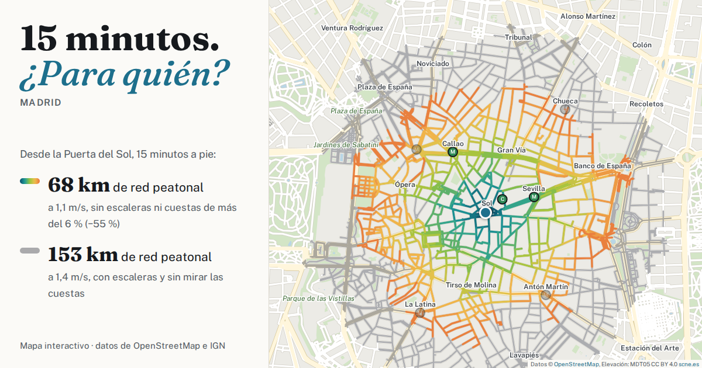

# 15 minutos. ¿Para quién? · Madrid y Navalcarnero



Herramienta exploratoria que muestra hasta dónde llegas andando en un tiempo dado, y cómo cambia según tu velocidad, si puedes usar escaleras y si tienes en cuenta las cuestas. Los mismos 15 minutos no llegan igual de lejos para todo el mundo.

**Pruébalo:** https://pablolamiquiz.github.io/15-minutos/

## Qué hace

- **Lugar.** Elige el lugar en el selector: Madrid (7 km alrededor de la Puerta del Sol) o Navalcarnero (5 km alrededor de la Plaza de Segovia).
- **Punto de salida.** Haz clic en el mapa, arrastra el punto o busca una calle, estación o parque.
- **Tiempo y velocidad.** El tiempo va de 5 a 30 min. La velocidad al caminar va de 0,8 a 1,8 m/s, el rango del metaestudio de [Giannoulaki y Christoforou, 2024](https://www.mdpi.com/2818476).
- **Escaleras.**
  - «Evitar escaleras» quita los tramos de escaleras mapeados.
  - «Escaleras» los marca en rojo en el mapa.
- **Cuestas.**
  - «Tener en cuenta las cuestas» hace que subir y bajar fuerte sea más lento, según la función de Tobler: un 16 % más lento con un 5 % de subida y un 30 % con un 10 %.
  - «Evitar cuestas de más del X %» quita los tramos cuya pendiente, medida en 10 m (30 m en Navalcarnero), supera el umbral. El umbral va del 4 al 12 % en pasos de 2.
  - El 6 % es el límite general de un itinerario peatonal accesible según la Orden TMA/851/2021. La norma admite rampas más empinadas en ciertas condiciones, así que el filtro no comprueba el cumplimiento.
  - Los tramos con pendiente incierta (junto a muros, bajo puentes o sin dato) se pueden tratar también como barrera y ver en el mapa.
- **Metro.** Las estaciones llevan una letra (M, C, ML). En las de Metro cuenta la llegada a cualquiera de sus bocas. Si evitas escaleras, una estación accesible solo cuenta si llegas a una boca etiquetada como accesible.
- **Mapa.** En color, las calles que alcanzas con tus ajustes. En gris, las que alcanzaría en el mismo tiempo alguien a 1,4 m/s que puede usar escaleras, sin contar las cuestas.
- **Panel.**
  - Da los kilómetros de red peatonal alcanzable: la suma de los tramos a los que llegas, no la distancia que recorres.
  - Cuenta los servicios al alcance: alimentación; farmacias, consultas y hospitales; colegios, escuelas infantiles y bibliotecas; zonas verdes y de juego; cafés, bares y restaurantes. También cuenta bancos, paradas de bus y estaciones.
  - Los servicios son elementos de OpenStreetMap, no un censo.
- **Compartir.** «Compartir esta vista» guarda el lugar, el punto y los ajustes en la dirección.
- **Idiomas.** En español y en inglés.

## Cómo funciona

No hay servidor. Los datos de cada lugar viajan con la página y el navegador calcula el recorrido con el algoritmo de Dijkstra (`core.js`). El mapa base se dibuja con los mismos datos, sin servicio de teselas.

Todos los ficheros están en la carpeta principal, sin subcarpetas, para que se puedan subir a GitHub de una vez seleccionándolos y arrastrándolos.

| Fichero | Qué es |
|---|---|
| `index.html`, `core.js` | La página y el cálculo |
| `leaflet.js`, `leaflet.css`, `fflate.min.js`, `*.woff2` | Bibliotecas y tipografías (`licencias-terceros.md`) |
| `cities.json` | Lugares disponibles; el selector se llena con este fichero |
| `<lugar>-graph.bin.gz` | Red peatonal. Cada tramo lleva sus trozos de pendiente: posición, pendiente máxima, factores de tiempo de subida y bajada, calidad |
| `<lugar>-extra.json.gz` | Nombres, parques, agua, fuentes y parámetros |
| `<lugar>-pois.json.gz` | Servicios, con sus enganches a la red |
| `<lugar>-audit-*` | Informes de generación: `build_report.json`, tipos y duplicados de servicios, enganches, `pois.csv.gz` con los ids de OpenStreetMap |
| `*.mjs` | Generación de los datos (`cli.mjs`, `build.mjs`, `slopes.mjs`, `terrain.mjs`…) y pruebas (`test_*.mjs`, `scenarios.mjs`) |

| | Madrid | Navalcarnero |
|---|---|---|
| Red peatonal | 201.368 tramos, 7.025 km (4.538 tramos de escaleras) | 3.708 tramos, 505 km |
| Destinos | 39.552 | 162 |
| Datos comprimidos | 4,5 MB | 97 KB |
| OpenStreetMap | Geofabrik, datos del 06/10/2026 | Geofabrik, datos del 01/10/2026 |
| Terreno | MDT 2025 del Ayuntamiento de Madrid (nivel de 2 m) | MDT05 del IGN (5 m), reconstruido entre curvas de nivel |
| Pendiente de barrera | máximo en ventanas de 10 m | máximo en ventanas de 30 m |

Los datos se generan con `cli.mjs` (Node ≥ 18):

```
node cli.mjs --city madrid --pbf madrid-261006.osm.pbf --out .
node cli.mjs --city navalcarnero --pbf madrid-261001.osm.pbf --out .
```

Para añadir otro lugar basta una entrada en `CITIES` (`build.mjs`), con su extracto de OpenStreetMap y su fuente de terreno.

`AUDITORIA.md` explica el método de pendientes, las comprobaciones y sus resultados. Las pruebas son `test_core.mjs`, `test_terrain.mjs`, `test_build.mjs` y `scenarios.mjs`.

Para verlo en tu ordenador:

1. Abre un Terminal en esta carpeta.
2. Ejecuta `python3 -m http.server 8000`.
3. Ve a http://localhost:8000.

Abrir `index.html` con doble clic no funciona, porque la página tiene que cargar los ficheros de datos.

## Limitaciones

- **Lo que no tiene en cuenta.** No incluye transporte público, bordillos, anchura ni estado de las aceras, ni iluminación.
- **Silla de ruedas.** «Evitar escaleras» y «Evitar cuestas» juntos no equivalen a una ruta en silla de ruedas.
- **Pendiente.**
  - Es la del eje de cada tramo, no la de la acera.
  - Junto a muros, en puentes y en pasos inferiores puede ser incierta. La página marca esos tramos.
- **Navalcarnero.**
  - El modelo del IGN tiene mucho menos detalle que el de Madrid, y el filtro de cuestas es solo orientativo: contrastado en Madrid, se equivoca de media en 1,6 puntos.
  - OpenStreetMap apenas tiene servicios mapeados en Navalcarnero, así que sus recuentos no son representativos.
- **OpenStreetMap en general.** Está incompleto en algunos sitios. Una estación solo cuenta como accesible si está etiquetada `wheelchair=yes`.

## Ideas para seguir

- Inventario oficial de bancos del Ayuntamiento ([datos.madrid.es](https://datos.madrid.es/dataset/300095-0-mobiliario-bancos)).
- Fuentes de agua, sombra, aseos.
- Actualizar los datos de OpenStreetMap periódicamente.

## Créditos y licencias

- **Origen del proyecto.** Basado en [«15 minutes. For whom?»](https://github.com/martincantcode/15-minutes) de Martin Bangratz, a su vez inspirado en la ciudad de 15 minutos de Carlos Moreno. Código bajo licencia MIT (ver `LICENSE`).
- **Elevación en Madrid.** MDT 2025 © Ayuntamiento de Madrid ([geoportal.madrid.es](https://geoportal.madrid.es)).
- **Elevación en Navalcarnero.** MDT05 © Instituto Geográfico Nacional, CC BY 4.0 [scne.es](https://www.scne.es).
- **Datos de OpenStreetMap.** © colaboradores de [OpenStreetMap](https://www.openstreetmap.org/copyright). Los ficheros de datos (`cities.json` y `<lugar>-*`) son una base de datos derivada de OpenStreetMap, disponible bajo la [Open Database License (ODbL)](https://opendatacommons.org/licenses/odbl/).
- **Bibliotecas y tipografías.** Leaflet (BSD-2), fflate (MIT) y las tipografías Fraunces y Public Sans (SIL OFL 1.1): ver `licencias-terceros.md`.

---

## English

Interactive map of how far you can walk in a given time, in Madrid (7 km around Puerta del Sol) or Navalcarnero (5 km around Plaza de Segovia), and how that changes with walking speed, avoiding stairs and avoiding slopes.

- **Slopes.** In Madrid they come from the City Council's 2025 terrain model, as the maximum over 10 m windows along each segment. In Navalcarnero they come from IGN's MDT05, rebuilt between contour lines and measured over 30 m. Tobler's hiking function sets walking times.
- **Metro.** Reach is measured to station entrances.
- **How it runs.** Everything runs in the browser on OpenStreetMap data (© OpenStreetMap contributors, ODbL) bundled with the page. There is no server and no tile service.
- **Origin.** Based on [“15 minutes. For whom?”](https://github.com/martincantcode/15-minutes) by Martin Bangratz (MIT).

Pick the place and the language on the page. Method and validation are in `AUDITORIA.md` (in Spanish).
